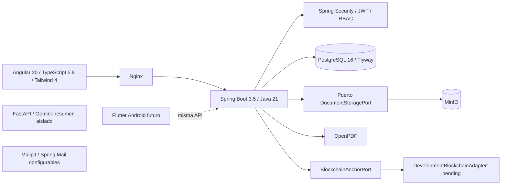
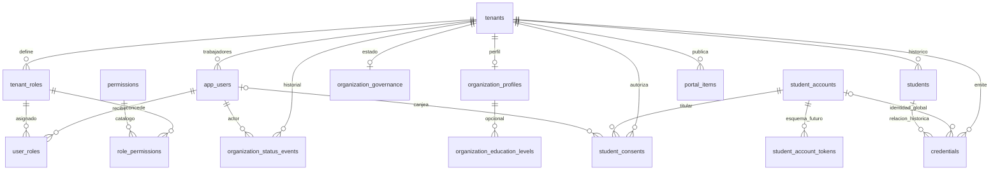

# Auditoría inicial del prompt maestro V3

Fecha: 2026-11-13 (America/La_Paz). Base revisada: commit `0f72612`, rama
`codex/rbac-superadmin`. El árbol de trabajo estaba limpio antes del incremento.
No se modifica main ni el checkout ajeno con trabajo pendiente del estudiante.

Esta auditoría conserva el diagnóstico inicial. La continuación SEC-01/SEC-02 ya
implementa revisión previa, seguridad estudiantil y V14; el estado actual y las
limitaciones están en [PRIORITY_01_DELIVERY.md](PRIORITY_01_DELIVERY.md).

## Resultado y alcance

Se revisaron estructura, dependencias, rutas Angular, controladores, autorización,
servicios de identidad/consentimiento/credenciales, almacenamiento, entidades,
migraciones, pruebas, Docker y contratos existentes. No es una certificación de
seguridad ni una prueba de penetración exhaustiva.

La base informada de **35 pruebas se reprodujo: 11 backend + 24 frontend**, sin
fallos ni pruebas omitidas. Backend compilado con Java 21 y `mvnw verify` contra
PostgreSQL 16 dedicado, Flyway habilitado y Hibernate `validate`; frontend compilado
en producción y probado con ChromeHeadless. Se instalaron V1–V13 desde cero.
Las posteriores inicializaciones del contexto validaron sus checksums.

Docker local responde: web `/register` 200, backend `/actuator/health` 200,
MinIO `/minio/health/live` 200 y FastAPI `/health` 200. PostgreSQL operativo tiene
13 entradas exitosas en `flyway_schema_history`. Los seis servicios del proyecto
están iniciados; PostgreSQL y Mailpit tienen health checks. No se tocaron servicios
de otros proyectos. Salud de MinIO no equivale por sí sola a probar escritura/lectura.

El resultado final del incremento y la prueba de almacenamiento real se registran
en [VALIDATION_V3.md](VALIDATION_V3.md).

## Arquitectura conservada

El núcleo es un monolito Spring modular por paquetes. FastAPI existe como servicio
auxiliar, no como reemplazo de reglas académicas. No se encontraron proyecto Flutter,
red blockchain, flujo OCR ni modelo de anomalías. Gemini requiere clave y no se
invocó durante esta auditoría. No se enviaron documentos a proveedores de IA.

| Capa | Evidencia principal | Observación |
|---|---|---|
| Web | `frontend/src/app/app.routes.ts`, `features/`, `core/` | Componentes standalone, señales, servicios HttpClient y guards; menú horizontal por acceso. |
| API | `backend/src/main/java/bo/edu/uagrm/credenciales/` | Paquetes auth, security, rbac, platform, tenant, identity, consent, student, credential, portal, storage, blockchain. |
| Seguridad | `SecurityConfig`, `JwtAuthenticationFilter`, `AccessService` | HMAC JWT; se recargan usuarios, permisos y estado institucional en cada petición; BCrypt. |
| Persistencia | JPA repositories + Flyway | Una base/esquema compartido con `tenant_id`, no esquemas por institución. |
| Documentos | `CredentialPdfService`, `MinioDocumentStorageAdapter` | Hash SHA-256, logo/colores y nombre del firmante; el nombre impreso no es firma digital. |
| Infraestructura | `docker-compose.yml`, `compose.prebuilt.yml`, Dockerfiles | Nginx, backend, PostgreSQL, MinIO, Mailpit y FastAPI; .env excluido de Git. |

Se mantienen los endpoints `/api/...` ya existentes. No se crean rutas `/api/v1`
paralelas. Los contratos RBAC y de organización siguen en `RBAC_CONTRACT.md` y
`ORGANIZATION_API.md`.

## Migraciones y diagnóstico de datos

| Versión | Cambio observado |
|---|---|
| V1 | tenants, app_users, credentials e índices por tenant/verificación. |
| V2 | Tipo institucional, students histórico, FK student_id en credenciales. |
| V3 | student_accounts globales, student_consents y student_account_id en credenciales. |
| V4 | Código EST aleatorio único por cuenta global. |
| V5 | Branding, logo, respaldo institucional y datos de firmante. |
| V6 | portal_items institucionales. |
| V7 | Identidad inicialmente opcional para registro con correo/contraseña. |
| V8 | Fecha de nacimiento y departamento. |
| V9 | Columnas de seguridad/identidad del estudiante y student_account_tokens. |
| V10 | token_hash pasa de CHAR(64) a VARCHAR(64). |
| V11 | Catálogo de 19 permisos; roles/asignaciones; superadmin sin tenant; gobernanza e historial. |
| V12 | Perfil legal, representante, niveles y unicidad país + identificación/licencia. |
| V13 | NIT/licencia admiten NULL; vacíos normalizados; unicidad de valores informados conservada. |

No se editó ninguna migración histórica y este incremento no necesita V14.
Hay **16 tablas de dominio**, más `flyway_schema_history`. Los registros V9/V10 no
demuestran que recuperación de cuenta o revisión de CI funcionen: sus columnas y
tokens aún no se usan en esta rama.

Integridad confirmada en SQL:

- `app_users` restringe SUPER_ADMIN a tenant NULL y trabajadores a tenant no NULL;
  los estudiantes están en otra tabla y no se agregan como empleados.
- `user_roles` referencia `(user_id,tenant_id)` y `(role_id,tenant_id)`: la base
  rechaza asignaciones entre organizaciones.
- Roles: unicidad de nombre normalizado por tenant. Usuarios: email por tenant;
  cuenta global de estudiante: email único y país/tipo/número únicos cuando existen.
- Un consentimiento tiene hash único y propietario; el código temporal caduca y
  se consume con bloqueo. El código EST es reutilizable/rotativo por decisión previa
  del producto y está almacenado como código, no como hash.
- Las FK históricas `credentials.student_id` no son compuestas por tenant;
  las nuevas emisiones utilizan `student_account_id` y consentimiento autorizado.
  No se deben fusionar ni eliminar registros históricos automáticamente.
- El acceso compartido depende de filtros de repositorio y servicios. No hay RLS
  PostgreSQL; completar cobertura de archivos, reportes y endpoints nuevos en T05.

## Inventario de los 18 módulos

«Parcial» significa que existe código funcional, pero faltan requisitos del módulo
completo. No se asigna porcentaje arbitrario ni se cuenta una dependencia instalada
como una funcionalidad terminada.

| Módulo | Estado | Evidencia existente | Falta frente al prompt |
|---|---|---|---|
| M01 Portal público | Parcial | Landing, registro general, accesos y verificación Angular. | Soporte/contacto operativo, revisión completa de accesibilidad. Conservar preferencia de interfaz clara. |
| M02 Autenticación/usuarios | Parcial | JWT, BCrypt, SUPER_ADMIN, TENANT_ADMIN, CUSTOM, permisos y usuarios. | Recuperación, correo confirmado, MFA, sesiones revocables, límites de intentos y accesos auditados. |
| M03 Gestión institucional | Parcial | Registro, perfil, branding, estados e historial. | Aprobación obligatoria inicial, unidades académicas configurables y administración de responsables. |
| M04 Personas | Parcial | Cuenta global, perfil, códigos y relaciones por consentimiento. | Verificación documental, expedientes por organización y revisión de duplicados con documentos distintos. |
| M05 Integración académica | Pendiente | No hay conectores académicos. | Contratos, autorización, adaptadores, sincronización y trazas. |
| M06 Solicitudes | Pendiente | No hay agregado de trámites ni máquina de estados. | Solicitudes, requisitos, responsables, adjuntos y observaciones. |
| M07 Plantillas | Parcial | PDF fijo con tres estilos, colores/logo y firmante. | Editor, campos dinámicos, versionado y previsualización. |
| M08 Emisión | Parcial | Borradores, lote, PDF/adjunto, hash, MinIO, código y QR web. | Requisitos/aprobaciones, firma, idempotencia, reconciliación y notificación. El QR aún no está incrustado en el PDF generado. |
| M09 Aprobaciones | Pendiente | Emisión directa por permiso. | Revisión, autoridad, separación de funciones e historial académico. |
| M10 Revocaciones/correcciones | Parcial | Revocar con motivo/fecha y estado público. | Solicitud, aprobación, sustitución, correcciones, historial de eventos y avisos. |
| M11 Blockchain | Parcial: estructura | Puerto y adaptador `pending:…`. | Decisión de red, transacciones reales, confirmación, revocación y recuperación. |
| M12 IA | Parcial: base técnica | FastAPI/Gemini para resumen, requiere clave. | OCR, reglas de anomalías, evidencias y revisión humana. |
| M13 Verificación pública | Parcial | Búsqueda por código, QR web, estado y datos públicos. | Comparar bytes/hash, firma, estado del emisor y lectura QR por cámara. ZXing instalado no equivale a escáner implementado. |
| M14 Auditoría | Parcial | Cambios de estado institucional con actor/fecha/motivo; canjes de consentimiento. | Bitácora transversal, consulta autorizada, retención y protección. |
| M15 Dashboards/reportes | Parcial | Contadores institucionales calculados desde listas y portal académico. | Indicadores globales, agregaciones filtradas, Chart.js real y exportaciones. |
| M16 Notificaciones | Pendiente | Spring Mail/dependencia y Mailpit; avisos del portal no son bandeja personal. | Persistencia interna, entrega/reintentos, correos y push. |
| M17 Android | Pendiente | Sin proyecto móvil. | Flutter/Dart, integración y compilación firmada. |
| M18 Mantenimiento | Parcial | Docker, Actuator y backup/restauración PostgreSQL manual documentado previamente. | Backups coordinados de MinIO, restauración ensayada, CI/CD, HTTPS, secretos y monitoreo de producción. |

## Hallazgos priorizados

| Hallazgo | Prioridad | Evidencia y siguiente medida |
|---|---|---|
| H01 Escritura MinIO anterior al rechazo de estado | P0 | `CredentialService.attachDocument`; reproducido con prueba roja. Corregido en este incremento: rechazo previo, objetos nuevos y bloqueo por credencial. |
| H02 Emisión repetida invocaba anclaje antes de validar estado | P0 | `issue`; ahora se valida DRAFT antes del adaptador, bajo el mismo bloqueo. No equivale a transacción distribuida. |
| H03 Altas institucionales se activan sin revisión | P0 | `Tenant` inicia active=true, `AuthService.register` devuelve sesión operativa; también existe alta legacy. Diseñar contrato de onboarding restringido y cubrir ambas rutas antes de exigir aprobación. |
| H04 Seguridad estudiantil de V9 no implementada | P0 | `StudentAccount` no mapea active/email_verified/identity_status; el principal usa enabled=true. Revisar trabajo ajeno pendiente antes de integrar, no asumir desactivación funcional. |
| H05 Sin recuperación/MFA/sesiones revocables/rate limiting | P0 | JWT expira pero no hay registro de sesiones ni flujos de recuperación. No declarar preparación para producción. |
| H06 Archivo externo y PostgreSQL no son una transacción atómica | P1 | Puede quedar un objeto huérfano si falla el commit. Usar claves nuevas evita dañar el objeto vigente; outbox/reconciliación quedan pendientes. |
| H07 Validación de archivos insuficiente | P1 | Adjuntos de credenciales no comprueban estructura PDF; logos/respaldo confían en MIME. Definir límites, firma de archivo, decodificación y manejo de contenido activo. |
| H08 Resultado «válida» excede las comprobaciones actuales | P1 | Verificación devuelve datos persistidos: no valida firma criptográfica, bytes actuales ni estado administrativo del emisor. Ajustar contrato/etiquetas con T16. |
| H09 Exposición operativa de desarrollo | P0 antes de producción | Puertos DB/MinIO/AI publicados y secretos de fallback; HTTP local. Evaluar aislamiento, configuración obligatoria y controles ASVS con evidencia. No se certifica ASVS. |
| H10 Ausencia de auditoría integral, restauración y CI | P1 | Solo bitácoras específicas, no workflow GitHub Actions. Un backup PG no demuestra recuperación PG+MinIO. |

No se crean módulos duplicados ni se alteran datos vivos para «arreglar» estos
hallazgos. El registro conserva los ocho tipos institucionales, identificadores
legales opcionales y ausencia de niveles en el asistente. Se mantiene la cuenta
global del estudiante y el menú horizontal actual.

## Siguiente ejecución

El backlog y sus dependencias están en [PRODUCT_BACKLOG_V3.md](PRODUCT_BACKLOG_V3.md).
El primer sprint está en [SPRINT_01_V3.md](SPRINT_01_V3.md). Este incremento resuelve
H01/H02 y refuerza T05/T14; no presenta esas dos tareas completas ni anuncia una
integración real de blockchain, IA documental o Android.
